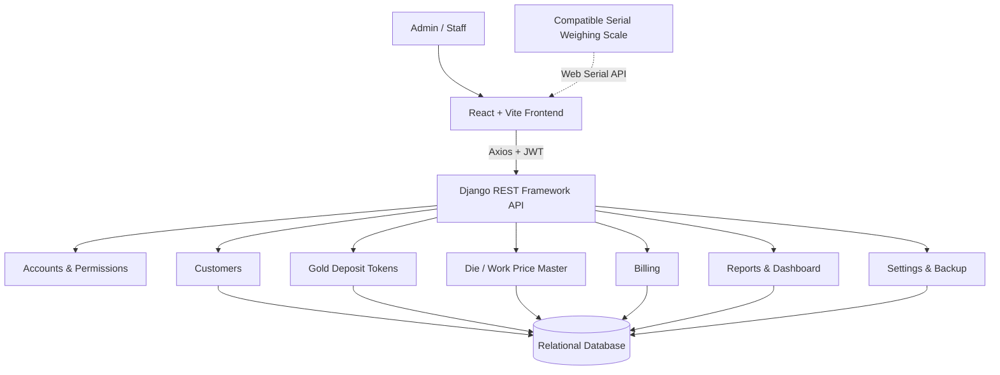

# Nellore Die Cutting — Jewellery Workshop Management System

<div align="center">


### A full-stack business application for managing customers, gold deposits, billing and workshop operations.

[](https://react.dev/)
[](https://www.djangoproject.com/)
[](https://www.django-rest-framework.org/)
[-003B57?style=flat-square&logo=sqlite&logoColor=white)](https://www.sqlite.org/)
[](https://vite.dev/)

[**Live Application**](http://nellorediecutting.shop/) · [**Source Code**](https://github.com/jahanur07/nellore-die-cutting)

</div>

---

## 1. Project overview

Nellore Die Cutting is a web-based management system designed for a jewellery die-cutting business. It brings everyday workshop operations into one application instead of relying on disconnected manual records.

The system connects customer information, gold-deposit entries, work/die pricing, billing, payment records and business reports. It provides separate experiences for administrators and staff, with access controlled by role.

**The main workflow:** register or find a customer → record a gold deposit and generate a token → select the work/die pricing → prepare a bill with gold return and payment details → review the transaction in dashboards and reports.

## 2. The problem it addresses

A workshop needs to keep customer and transaction details organised and make it easy to trace a deposit through to billing. Manual processes can make it harder to find previous records, maintain consistent rates, calculate totals and review business activity.

This application is designed to help with:

- Keeping customer profiles and transaction history together.
- Recording gold deposits with traceable token numbers.
- Maintaining a central list of die/work names and rates.
- Preparing bills with item quantities, gold return, discounts and payment methods.
- Separating administrator controls from day-to-day staff operations.
- Reviewing daily, monthly and custom-period business summaries.

## 3. Main features

| Module | What it does |
|---|---|
| **Authentication & accounts** | Admin setup, staff/admin login, JWT-based API authentication, password reset and user management |
| **Role-based dashboards** | Separate admin and staff dashboards with business activity summaries and recent transactions |
| **Customer management** | Create, search, view and update customer records; customer codes and transaction summaries |
| **Gold deposit tokens** | Record gold weight, customer details and remarks; generate sequential token numbers and look up tokens |
| **Die/work price master** | Maintain die/work names, codes and rates; import die-price data from Excel using a template |
| **Billing** | Create bills from customer tokens, add bill items and quantities, calculate totals and discounts, record cash/online payments and gold returned |
| **Reports & analytics** | Daily, monthly and custom date-range summaries, gold movement, billing totals and payment breakdowns |
| **Business settings** | Shop profile, logo, bill/token formats, prefixes, decimal settings, users and permissions |
| **Data backup** | Admin-only JSON backup export for core business records and settings |
| **Weighing machine integration** | Optional browser-based serial connection using the Web Serial API, live readings and stable-weight detection; manual entry can be configured |
| **Printing** | Customer bill/token print workflows and configurable paper sizes |

> Feature descriptions are based on the current source code. Some hardware features require a compatible weighing scale, supported browser and HTTPS/localhost. The live application may require authorised login.

## 4. Technology stack

### Frontend
- React 19 for the component-based user interface.
- Vite 8 for local development and production builds.
- React Router for page navigation and protected routes.
- Axios for communication with the backend API.
- Recharts for dashboard/report charts.
- jsPDF for PDF output in reporting workflows.
- React Icons for interface icons.
- Browser Web Serial API for supported weighing-machine connections.

### Backend
- Python and Django 6.0.1.
- Django REST Framework 3.16.1 for REST APIs.
- Simple JWT for bearer-token authentication.
- Django ORM for data modelling and queries.
- django-cors-headers for frontend/backend cross-origin configuration.
- openpyxl for Excel import/template workflows.
- Gunicorn as the documented WSGI application server.

### Data and deployment
- SQLite is the database configured in the checked-in Django settings for local development.
- The deployment guide recommends a persistent production database (such as PostgreSQL) and persistent media/object storage for production.
- Frontend deployment target: Vercel (see the live application link).
- Backend deployment instructions: [DEPLOYMENT.md](DEPLOYMENT.md).

## 5. How the application is structured

The frontend and backend are separate applications. React calls Django REST endpoints; Django validates requests, applies permissions and uses the ORM to persist business records.



### Backend modules

- `accounts` — login, initial admin setup, password recovery, managed users and role permissions.
- `customers` — customer records, lookup, summaries and staff-edit access.
- `tokens` — gold-deposit token creation, numbering and customer/token lookup.
- `masters` — die/work pricing, Excel template and import.
- `billing` — bills, bill items, amounts, discounts and payment methods.
- `reports` — date-based reporting and transaction summaries.
- `settings_app` — shop/system configuration, weighing-machine settings, logo upload and backup export.

### Main frontend areas

- `frontend/src/pages/auth/` — admin/staff login, setup and password recovery.
- `frontend/src/pages/dashboard/` — admin and staff dashboards.
- `frontend/src/pages/customers/` — customer management.
- `frontend/src/pages/tokens/` — gold-deposit token workflow.
- `frontend/src/pages/masters/` — die/work price management.
- `frontend/src/pages/billing/` — billing workflow.
- `frontend/src/pages/reports/` — reports and charts.
- `frontend/src/pages/settings/` — business and system settings.
- `frontend/src/services/` — API calls grouped by feature.
- `frontend/src/hooks/useWeighingMachine.js` — serial weighing-scale connection and stable-reading logic.

## 6. Important engineering decisions

A few implementation details worth exploring in the source:

1. **Role-aware access:** protected frontend routes are paired with backend permission checks. Sensitive operations such as managing die prices and system settings are restricted to administrators.
2. **JWT API requests:** the Axios client attaches a bearer token to API requests and handles expired/unauthorised sessions.
3. **Traceable transaction records:** customers, tokens, bills and bill items are connected through model relationships.
4. **Server-side bill calculations:** bill-item amounts are calculated on the backend from rate × quantity, rather than trusting a browser-submitted total.
5. **Historical price snapshots:** bill items retain die code, work name and rate values so a later master-price edit does not rewrite the values stored on an earlier bill.
6. **Operational safeguards:** customer records with linked transaction history are protected from deletion; staff editing can be controlled by an administrator.
7. **Hardware integration:** the weighing hook parses serial readings, normalises kilogram readings to grams and waits for consecutive stable samples before exposing a stable weight.
8. **Configurable business behaviour:** settings cover numbering prefixes, weight/amount precision, receipt paper size, manual weight entry and token editing.

## 7. Data model at a glance

| Entity | Purpose | Relationship |
|---|---|---|
| Customer | Customer identity and contact details | Has many tokens and bills |
| Token | Gold deposit record and token number | Belongs to a customer; can be referenced by bills |
| DiePrice | Die/work name, code and rate | Referenced by bill items |
| Bill | Billing transaction, gold return and payment | Belongs to a customer and token |
| BillItem | Work line, quantity, rate and amount | Belongs to a bill and references a die price |
| StaffAccount / User | Staff profile and authentication | Used to record who created records |
| SystemSettings | Business, receipt and hardware configuration | Controls application behaviour |

## 8. Run the project locally

### Prerequisites
- Python version compatible with the Django project.
- Node.js and npm compatible with the Vite project.
- Git.

### Backend setup

```bash
git clone https://github.com/jahanur07/nellore-die-cutting.git
cd nellore-die-cutting

python -m venv .venv
source .venv/bin/activate        # macOS / Linux
# .venv\Scripts\activate       # Windows

pip install -r backend/requirements.txt
cp backend/.env.example backend/.env
```

Set a local Django secret key and the required environment values in your local environment file. Do not commit real secrets.

```bash
python backend/manage.py migrate
python backend/manage.py createsuperuser
python backend/manage.py runserver
```

The backend runs at `http://127.0.0.1:8000` by default.

### Frontend setup

Open a second terminal from the repository root:

```bash
cd frontend
npm ci
cp .env.example .env
```

Set `VITE_API_URL=http://127.0.0.1:8000/api` in the local frontend environment file, then run:

```bash
npm run dev
```

Vite prints the local frontend URL in the terminal.

## 9. Tests and quality checks

The backend contains Django REST Framework API tests in the feature apps, including account recovery, customer permissions/deletion, die-price permissions and Excel template behaviour, and token creation/lookups.

Run the backend test suite from the repository root:

```bash
python backend/manage.py test
```

Frontend scripts currently include:

```bash
cd frontend
npm run lint
npm run build
```

These are the available checks; run them in your environment and record the actual results before presenting them as passing.

## 10. Deployment

The repository includes a deployment guide: [DEPLOYMENT.md](DEPLOYMENT.md).

At a high level:
- Deploy the React build as a frontend service.
- Deploy Django as a separate backend service.
- Configure the frontend API base URL and backend allowed hosts/CORS/CSRF origins.
- Use production secrets through the hosting provider's environment settings.
- Use persistent production database and media storage.
- Run migrations, collect static files and verify authentication, billing, reports, password reset and uploads after deployment.

**Live frontend:** http://nellorediecutting.shop/

## 11. My contribution & what I learned

This project demonstrates full-stack work across:

- Translating a real business workflow into application modules and user journeys.
- Building React pages, protected navigation and reusable API service layers.
- Designing Django models, serializers, views and REST endpoints.
- Implementing role-aware operations for administrators and staff.
- Connecting related records across customer, token, pricing and billing workflows.
- Handling calculations, reporting, imports, exports and printing.
- Integrating a browser-supported serial weighing device.
- Configuring frontend/backend environments and deployment.

When discussing this project in an interview, explain the parts you personally designed, coded, tested and deployed. Be ready to open the relevant files and walk through one complete workflow rather than claiming every feature was independently built by one person.

## 12. Interview walkthrough

A useful 3–5 minute demonstration:

1. **Problem:** Explain the workshop workflow and why customer, deposit and billing records need to be connected.
2. **Architecture:** Show the React frontend, Django REST API and database relationship.
3. **User roles:** Explain the difference between administrator and staff access.
4. **Core workflow:** Walk through customer → gold deposit token → die/work selection → bill → payment.
5. **Engineering detail:** Show backend bill-item calculation or the stable-weight logic in `useWeighingMachine.js`.
6. **Quality and deployment:** Point to API tests and `DEPLOYMENT.md`; explain what you verified yourself.

### Questions to prepare for

- Why did you separate React and Django instead of building a single server-rendered app?
- How does JWT authentication work between the frontend and backend?
- How do you prevent staff users from changing administrator-only master data?
- How are token numbers and bill numbers generated?
- Why does the backend calculate bill-item amounts?
- How do you preserve historical bill prices if the master rate changes?
- How does the weighing-machine integration detect a stable reading?
- What would you improve before scaling this application for more users?

## 13. Repository structure

```text
nellore-die-cutting/
├── backend/
│   ├── accounts/
│   ├── billing/
│   ├── customers/
│   ├── masters/
│   ├── reports/
│   ├── settings_app/
│   ├── tokens/
│   ├── backend/
│   ├── requirements.txt
│   └── manage.py
├── frontend/
│   ├── src/
│   │   ├── components/
│   │   ├── hooks/
│   │   ├── pages/
│   │   ├── services/
│   │   └── utils/
│   ├── package.json
│   └── vite.config.js
├── DEPLOYMENT.md
└── README.md
```

---

<div align="center">

### Built to make a real business workflow easier to manage.

**React · Django REST Framework · Python · Full-Stack Development**

[Live Application](http://nellorediecutting.shop/) · [GitHub Repository](https://github.com/jahanur07/nellore-die-cutting)

</div>
